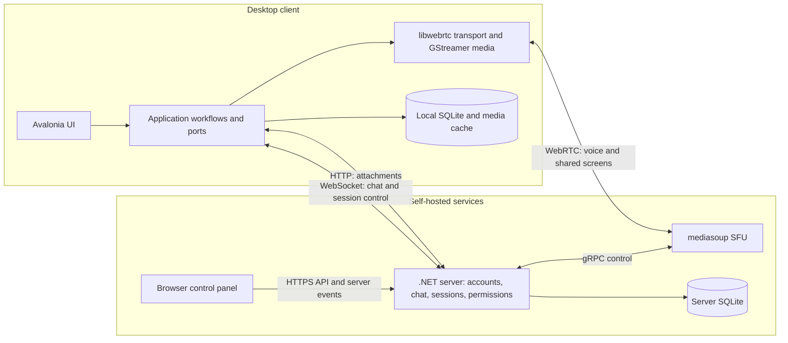

# System architecture

## Runtime components

Arrows represent communication and responsibilities, not assembly dependencies. Attachments travel separately from real-time media. The local database and media cache are separate storage concerns.

The normal Docker setup runs the server and SFU as two containers with host networking. Its default ports are 26666/TCP for client connections, 4433/TCP+UDP for media, 50051/TCP for local server-to-SFU control, and 7114/TCP for the control panel. The panel has no authentication and is bound to loopback by default; remote administration uses an SSH tunnel.

## Boundaries and tradeoffs

| Decision | Purpose | Cost or limit |
|---|---|---|
| Separate session control from media forwarding | Let the .NET application own permissions and session state while mediasoup handles forwarding. | Requires coordination across WebSocket, gRPC, and WebRTC lifecycles. |
| Put external services behind application ports | Exercise workflows without launching UI hosts or native media runtimes. | Adapter behavior still requires integration and platform checks. |
| Share protocol definitions through a Git submodule | Give client and server explicit, versioned wire types. | Releases must retain compatibility; matching source types alone does not prove interoperability. |
| Separate media transport from capture and codecs | Use libwebrtc networking with desktop GStreamer media pipelines. | Native resource ownership and synchronization need explicit contracts. |
| Use SQLite persistence | Keep local state and server data in embedded databases. | Capacity must be measured for the actual workload; this does not establish multi-host database scaling. |

Desktop normally selects libwebrtc for transport, with an experimental GStreamer transport and fallback when the native library is unavailable. Android uses libwebrtc and platform media services, can watch screen shares, and does not originate them. Desktop GPU paths depend on OS, drivers, codecs, and capture support. See the [repository conventions](../../AGENTS.md) for platform boundaries.

## Joining and recovering a voice session

1. The client connects to the coordinator and authenticates through the shared control protocol.
2. The server applies session permissions and admission rules. An assigned, connected SFU provides the media transport.
3. The client negotiates WebRTC and starts the selected media backend. The SFU forwards media between participants.
4. If the assigned SFU disconnects, the server uses an available assigned alternative. Participant membership remains, but media state resets and clients must rejoin the transport, so playback can pause.
5. If no assigned SFU is available, the session waits. Clients can retain membership and receive a transport when a node becomes available; host admission still applies.

Selection distributes sessions by session ID across connected assigned nodes. It does not measure CPU or bandwidth. Healthy sessions stay on their existing node when another node is added or recovers. The default two-container deployment has one SFU; it cannot demonstrate failover to a second node without additional configuration.

## Verification boundaries

Client CI runs application, infrastructure, WebSocket, localization, and shared protocol tests on Windows and Linux. Server CI runs .NET tests and type-checks the SFU and control panel. These describe the configured checks, not the status of a particular commit.

Server architecture tests enforce assembly boundaries. Recovery tests use fake SFU gateways to verify state transitions. Real audio, screen capture, GPU rendering, and recovery across live services require separate runtime checks. The [test bot](../../src/Client/Client.TestBot/README.md) supports those checks but does not by itself establish production capacity.

Optional local database encryption does not cover cached attachments or logs and does not imply end-to-end conversation encryption. Webcam calling is not currently implemented.
